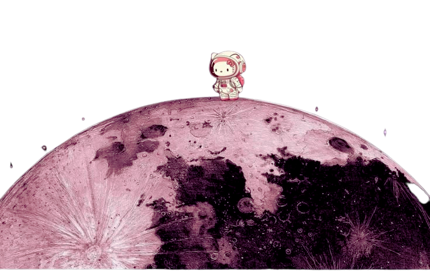
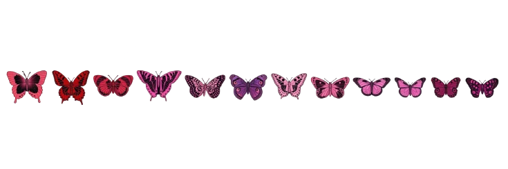

 

# ☾ 𝒴𝓊𝓁𝒾𝒶𝓃𝒶 ☽

### 🥀 Welcome to my enchanted corner 🥀

 

 

---

## 🥀 About me

Hello! I'm **Yuliana** ♡

I'm exploring the world of programming, technology and creative development.

-  Learning something new every day.
-  Interested in software development.
-  I love creativity and digital aesthetics.
-  Always looking for new things to create.

---

## ☘ My skills & tools

<!-- Keep only the technologies you actually know -->

## 🕯️ Currently learning

- ✧ Improving my programming skills.
- ✧ Exploring new technologies.
- ✧ Creating my own projects.

---

## 🍷 My little creations

| Project | Description |
|:---:|:---|
| 🥀 Project 01 | Coming soon... |
| ☾ Project 02 | Coming soon... |
| ☘ Project 03 | Coming soon... |

---

### ☾ Thanks for visiting my little world ☽

*Even in the darkest forest, flowers bloom.*

🥀 ✧ ☘ ✧ 🦋

